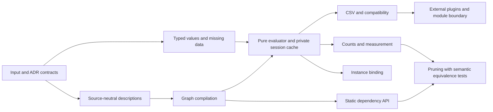

# Proposed development sequence after issue #168

Date: 2026-10-29. Baseline: master `989d1c9d3fcc5fc86c3a052179b9f0a7e34f5c94`.
**Status: proposal for discussion, not an accepted ADR or an executable replacement for plan.md.**

## Evidence and current position

Master has been fast-forwarded to the merged graph implementation. Its Git tree matches the
previously verified PR head `401a815`; that tree passed 106 tests and Qulice in the preceding
implementation work. This analysis did not rerun those checks or change production code.

The [live backlog review](issue-review-after-168-2026-10-29.md) found seven open issues and no
open PRs. [#168](https://github.com/nergal-perm/java-decita/issues/168) is completed and
[#169](https://github.com/nergal-perm/java-decita/pull/169) is merged. Earlier reports remain
historical evidence; their pre-merge limitations must not be presented as the current graph state.

Three pieces now coexist:

1. The working legacy evaluator: [`ComputationContext`](../src/main/java/ru/ewc/decisions/api/ComputationContext.java)
   still loads CSV, returns string outcomes, logs evaluation and performs state-changing assignments.
2. Immutable graph descriptions: [`ConditionNode`](../src/main/java/ru/ewc/decisions/core/ConditionNode.java)
   stores a `RuleFragment`; [`RuleNode`](../src/main/java/ru/ewc/decisions/core/RuleNode.java)
   stores a copied fragment list; the graph validates structure and canonical references.
3. The value-provider prototype: [`ValueProvider`](../src/main/java/ru/ewc/decita/core/value/ValueProvider.java)
   and [`ConstantValueProvider`](../src/main/java/ru/ewc/decita/core/value/ConstantValueProvider.java).

There is no new `DecisionEngine`, `ExecutionContext`, complex-object provider, undefined provider,
graph compiler from source descriptions, or ServiceLoader-based extension composition in the
inspected sources. The existing [`GraphSessionIsolationTest`](../src/test/java/ru/ewc/decisions/core/GraphSessionIsolationTest.java)
creates fresh **legacy** evaluations from shared descriptions. It proves representation reuse,
not execution of a shared graph by the future engine.

The next valuable milestone is therefore a complete pure decision through the new graph and
typed inputs. Finishing disconnected data structures or starting pruning first would leave the
main architecture unproven.

## ADR implementation matrix

Accepted is a decision status, not an implementation-completion status.

| ADR | Current evidence | Remaining work / treatment |
| --- | --- | --- |
| [0001](adr/0001-record-architecture-decisions.md), decision records | ADRs exist | Continue the process; not a standalone runtime feature. |
| [0002](adr/0002-separation-of-engine-and-connectors.md), engine/connectors/SPI | Old `ContentsReader` is an input seam, but its model remains tied to legacy parsing/evaluation; no new SPI composition | Source-neutral contract, one real connector, pure engine boundary, then plugin discovery and an external extension test. |
| [0003](adr/0003-shared-component-management-and-evaluation-optimization.md), shared graph/session | Immutable representation and canonicalization implemented | Automatic construction, actual graph evaluation, private per-session memoization, reuse across real decision calls. |
| [0004](adr/0004-execution-context-key-strategy.md), object-identity cache | Canonical graph references implemented | No execution cache yet. Use explicit identity semantics: graph nodes override value equality, so an ordinary HashMap does not itself establish reference-identity keying. IdentityHashMap in graph validation is not an execution cache. |
| [0005](adr/0005-pure-functional-core.md), pure core | Graph representation is pure; legacy evaluator remains effectful | New evaluation must return decisions/action descriptions from input snapshots, with no file/network access, logging or application-state writes inside evaluation. |
| [0006](adr/0006-valueprovider-design-for-remote-data-and-composability.md), composed remote providers | No remote/provider composition implementation | Reconcile with 0005 and 0009 before implementing its original object-path/remote-read design. Preserve the goal of avoiding duplicate acquisition. |
| [0007](adr/0007-type-discovery-at-graph-construction-time.md), reflection-based typing | No implementation; still marked Accepted | Its object-path reflection approach needs an explicit relationship to 0009, which removes that approach. Do not implement it verbatim while this remains unresolved. |
| [0008](adr/0008-type-inference-for-constants.md), contextual inference | Explicitly superseded by 0009 | Historical context, not a separate implementation task. Literal conversion still needs a precise contract under 0009. |
| [0009](adr/0009-authoritative-value-typing-via-contextual-providers.md), typed flattened inputs | Generic constant wrapper only | Complex provider, typed input contract, conversion of literals, invalid-conversion behavior and expression evaluation. |
| [0010](adr/0010-handling-missing-fields-in-complexobjectvalueprovider.md), undefined provider | Not implemented | Undefined representation, lookup return type and expression semantics for missing data. |

## Contract decisions before the next production type

These are proposals to reconcile existing records, not silently adopted architectural changes.
Discuss the changes and record accepted amendments/supersession through the repository's ADR process.

**Typed values and missing data.** ADR-0009 calls the provider `ComplexObjectDataProvider`, while
0010 and the [original plan](../plan.md) call it `ComplexObjectValueProvider`. ADR-0009's
`Map<String, ConstantValueProvider<?>>` is a storage contract; it does not by itself define a
lookup return type that can also yield `UndefinedValueProvider`. Agree one name, the lookup/value
contract, and missing/null/invalid-conversion distinctions before fixing signatures. A real String
`"undefined"` must remain distinguishable from missing data. Do not silently replace the accepted
undefined-provider decision with Optional or null.

**Snapshot values.** `ConstantValueProvider<T>` currently retains and returns the supplied `T`
reference. A final field does not freeze a mutable List or application object. This is an unresolved
input contract, not a claim that every current constant is unsafe. Start with explicitly supported
immutable leaf types, or define connector normalization/copy responsibilities; do not promise a
generic deep copy of arbitrary Java objects.

**Purity and acquisition.** ADR-0006 places fetching orchestration inside a provider, while 0005
requires all data to come from inputs. Delegating an HTTP call does not make an evaluation that
triggers it pure. Recommended first implementation: connectors acquire/flatten/type an immutable
input snapshot before the core call. Remote calls and fetch caches remain outside the core. If
data keys can only be discovered during evaluation, a later explicit acquisition protocol needs
its own agreed contract rather than hidden I/O in the evaluator.

**Typing time and context roles.** Reconcile 0007 with 0009: decide whether a connector supplies
type/schema information before graph construction or literal conversion uses actual typed inputs
at evaluation time. Recommended initial path follows 0009's authoritative input types and avoids
new reflection/object traversal. Distinguish immutable evaluation inputs from the mutable,
private session memo table of 0003. Replace the prototype's dependency on the legacy
`ComputationContext` as that new boundary is introduced.

## Recommended mainline

Each row is a capability milestone, not one giant commit or one test. Retain one failing test,
one minimal behavior change, a green suite and a reviewable commit per increment.

| Step | Deliverable | Why here / evidence of completion |
| --- | --- | --- |
| 0 | Reconciled input/undefined/purity contracts and ADR relationships | Removes mutually incompatible API assumptions before implementing them. Fix stale documentation alongside this bounded review. |
| 1 | Typed input providers, including missing values | Continues the unfinished original plan and supplies real data to the future engine; no network or legacy context required. |
| 2 | Minimum source-neutral rule/expression model, [#170](https://github.com/nergal-perm/java-decita/issues/170) | Separates operators, references and literals from CSV cell parsing; one equivalent rule can be supplied without files. Exact class names/representation remain a design choice. |
| 3 | Description-to-graph compilation and static dependencies, [#162](https://github.com/nergal-perm/java-decita/issues/162) | Reuses #168's graph infrastructure; the graph's relationships are derived from actual rules, not manually drawn test fixtures. |
| 4 | First pure graph decision, then session-local evaluation/cache, ADR-0003/0004/0005 and part of [#165](https://github.com/nergal-perm/java-decita/issues/165) | Closes the central integration gap: the new graph and typed inputs actually determine a result. |
| 5 | CSV connector and a bounded legacy migration path | The same pure evaluation works on a real table. Preserve declared legacy behavior, and return assignment intentions before an outer adapter applies them. |
| 6 | Shared behavior bound to distinct instances, [#164](https://github.com/nergal-perm/java-decita/issues/164) | Demonstrates useful graph reuse in the factories scenario; settle [#163](https://github.com/nergal-perm/java-decita/issues/163)'s namespace syntax only if that scenario needs it. |
| 7 | External extension and public module boundary, completing ADR-0002's SPI slice | A connector/operator extension runs without changing the core. Compose ServiceLoader plugins outside evaluation, and test a real consumer/module boundary. |

Measurement is a branch off the minimal evaluator, not a prerequisite for building every feature:
[#166](https://github.com/nergal-perm/java-decita/issues/166) counts/aggregation should establish a
baseline **before** #165 pruning. Timing and sophisticated optimization follow a concrete question.
This branch can be scheduled after step 4 or alongside later integration work; it need not block CSV.

## Acceptance boundaries for the milestones

**Step 1: finish the provider slice.** Empty provider; absent key yields the agreed undefined
provider; existing String value is returned with its type; mixed Boolean/Double/String/LocalDate
entries preserve types; changing the caller's map cannot change the snapshot. Add null and mutable
leaf cases according to the contract decision. The original plan contains these first behavioral
increments but lacks snapshot and undefined semantics. Do not complete its checkbox just because a
constructor exists without testing the consumer-visible lookup contract.

**Step 2: make one expression independent of CSV.** Begin with one equality/reference/literal,
then numeric comparison and negation. Separate the comparison operator from its literal lexeme;
do not force the evaluator to recover it from `">18"` through legacy `Condition.from`. A separate
operator representation is a recommendation, not wording mandated by #170. Define extension-facing
contracts here, while postponing plugin discovery. Do not add YAML simply because the issue names
it as a possible reader.

**Step 3: compile and expose real dependencies.** One rule, two rules sharing an operand, a fallback,
then a table whose outcome feeds another. Derive the relevant graph relationships and preserve
canonical sharing. Report direct/transitive static dependencies; diagnose missing table references
and source-level cycles. Existing cycle validation checks supplied edges, not whether all source
dependencies were extracted. External input absence follows the undefined contract, not automatically
the same error policy as a broken table reference. Dynamic references retain unresolved descriptions
until a binding is supplied; do not report a complete concrete dependency set prematurely.

**Step 4: prove the actual new execution path.** One typed input and condition select a named outcome;
then fallback, contradictory/multiple matching rules, chained tables and literal-conversion errors.
The first end-to-end new-core test must use the graph evaluator, not create fresh legacy Conditions
from graph metadata. The same graph with age 21 and age 17 must read each call's own snapshot, in
both orders and on separate threads. A node reused by several paths is evaluated once per session;
a second session starts with independent cached values. Reference identity must be explicit even
for distinct objects that compare equal by value. Ephemeral memo mutation is internal to a fresh
session and does not modify input snapshots, graph nodes or later calls.

Use #164's two-factory example as an acceptance scenario already in this step: callers can provide
different snapshots under the same logical names before committing to a `this` language feature.
Return deterministic evaluation evidence when needed; perform logging/clock reads outside the pure
decision boundary. The visible result and action descriptions must depend only on graph and inputs.

**Step 5: make the new path useful to clients.** Convert the current semicolon dialect to the same
source-neutral description/graph. Preserve CND/OUT/ASG/HDR, explicit/implicit fallback, nested and
multiple placeholders, and ambiguity behavior through migration cases. Start with one table and
extend one behavior at a time. New decisions can be typed; keep a deliberate compatibility adapter
for the old string-map API until migration is accepted. ASG produces action/assignment descriptions;
an outer adapter applies them to State. Diagnose unreadable/malformed/empty sources at the connector
boundary, instead of silently losing tables or leaking array-index errors. Document dialect limits;
full CSV quoting support is a separate feature, not an automatic requirement of the rewrite.

**Step 6: bind instances deliberately.** Two factories share one graph but retain distinct workers
and owners, without rebinding or mutating the graph. Specify collisions between data/table names,
logical binding names and the lifetime of a binding. #163 proposes research and tentative syntax;
`this::property` is not an already accepted language requirement. Concrete dynamic dependencies
can then be resolved against a supplied binding.

**Step 7: prove modularity.** A test extension contributes an operator or connector through the
agreed SPI and receives the same abstract inputs. No source-format branch or new operator switch
is added inside the evaluator. ServiceLoader runs at composition/bootstrap time. Specify the public
package/JPMS exports, keep implementation packages private, and test an external consumer. Current
graph/value packages are unexported; blindly exporting the whole legacy core is not the only option.
Keep the initial in-memory evaluator independent of a later physical multi-artifact split.

**Measurement and pruning.** First observe real evaluation counts, then aggregate across sessions
and add timings outside the core if useful. Only then reorder/prune work. Optimizations must preserve
outcomes, fallback, undefined/error behavior and multiple-match detection: stopping after the first
true rule would silently change this library's unique-match semantics.

## Small housekeeping queue

- Review closing or refreshing [#23](https://github.com/nergal-perm/java-decita/issues/23): its
  five child puzzles are closed and the latest bot comment says they are solved. No remote change
  is authorized by this proposal alone.
- Update the [core graph README](../src/main/java/ru/ewc/decisions/core/README.md): its
  `someCondition` example predates the immutable-description API, and its claim of no allocation
  during traversal conflicts with query methods collecting new sets. The top-level README also
  retains development/unmerged wording after merge. These are documentation corrections, not new
  engine features or reasons to repeat #168.
- Turn the next agreed milestone into a small executable section of `plan.md`; retain the provider
  history and completed #168 checklist. Add issue/ADR references and observable acceptance tests.
  Do not paste the entire roadmap as an undifferentiated list of class constructors.

## Recommended immediate next work product

Agree and record the short typed-input/missing-value contract amendment, then add the original
plan's first unimplemented provider test and continue its lookup/snapshot behavior in small cycles.
The first substantial integration goal after that is **#170 plus one real pure decision through the
graph**. Keep #162 as an early useful output of compilation, and reserve pruning until actual
evaluation counts exist. This sequence is recommended from source dependencies, not mandated by
issue numbering or by the fact that an ADR is marked Accepted.
